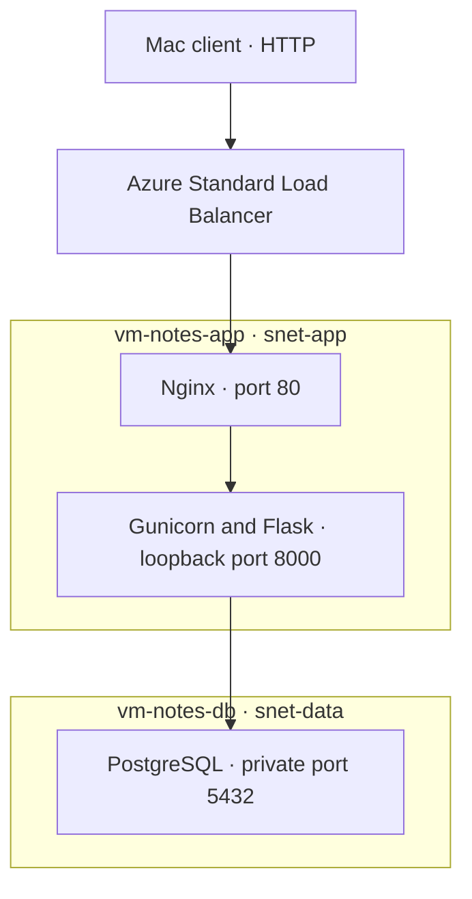

# Azure Notes API

An Azure lab that deploys a small notes API and tests private database access, end-to-end requests, and recovery after a web service outage.

## Architecture



The lab ran in Central India. A four-vCPU regional quota led to a two-VM design with Nginx and Flask on the same private VM. The load balancer has one backend, so the outage exercise measures detection and recovery. NAT Gateway supplies outbound package access. The public HTTP endpoint is restricted to the tester's public IPv4 address and used with sample data.

## Repository files

| Path | Purpose |
| --- | --- |
| `app/app.py` | Flask API with PostgreSQL reads and inserts |
| `nginx/notes.conf` | Reverse proxy and local health endpoint |
| `systemd/notes-api.service` | Gunicorn service and protected credential loading |
| `sql/setup.sql` | Database, table, and application role |

## Deployment outline

1. Create one VNet with private app and data subnets. The lab used `10.20.0.0/16` for the VNet, `10.20.2.0/24` for the app, and `10.20.3.0/24` for the database. It also had an unused web subnet at `10.20.1.0/24`. Attach a NAT Gateway for outbound package access and deploy two Ubuntu 24.04 VMs with private IPs.
2. Configure subnet NSGs. Give the two port 80 allow rules higher priority than the deny rule. The Azure Load Balancer health probe uses the `AzureLoadBalancer` service tag. The NSG on the data subnet allows TCP 5432 from the app subnet. PostgreSQL further limits the app login to the app VM's private IP.
3. On the database VM, install PostgreSQL with `sudo apt-get install -y postgresql`. Run the SQL file through `psql` as the local PostgreSQL administrator. For example, copy it to `/tmp/notes-setup.sql`, then run:

   ```bash
   sudo -u postgres psql -X -d postgres -f /tmp/notes-setup.sql
   ```

4. Set `listen_addresses` to `localhost,<DB_PRIVATE_IP>` and add the following rule to `pg_hba.conf`, using the actual private app IP. Restart PostgreSQL after setting the listening address.

   ```text
   hostssl notesdb notes_app <APP_PRIVATE_IP>/32 scram-sha-256
   ```

5. Provision a unique password for `notes_app`. In an interactive private administration session, run `sudo -u postgres psql -X -d notesdb` and use `\password notes_app` to set it. On the app VM, store the matching libpq password-file entry below in `/etc/notes-api/pgpass` with root ownership and mode `0600`. In the portal-only lab, the password was generated on the app VM and its SCRAM verifier was applied on the database VM. Keep both forms of the credential out of Git.

   ```text
   <DB_PRIVATE_IP>:5432:notesdb:notes_app:<PASSWORD>
   ```

6. On the app VM, install `nginx curl gunicorn python3-flask python3-psycopg2 postgresql-client`. Copy the application to `/opt/notes-api/app.py` and update its database host if the DB VM uses a different private IP. The lab uses PostgreSQL TLS with `sslmode=require` and Ubuntu's test certificate.
7. Copy the systemd unit to `/etc/systemd/system/notes-api.service`. Run `sudo systemctl daemon-reload` and `sudo systemctl enable --now notes-api.service`. Install the Nginx site in `/etc/nginx/sites-available/notes`, link it into `sites-enabled`, and remove the default site's symlink on a dedicated lab VM. Run `sudo nginx -t` before restarting Nginx.
8. Create a public regional Standard Load Balancer with the app VM in its backend pool. Add a TCP rule from frontend port 80 to backend port 80 and an HTTP probe on port 80 with path `/health`. Keep outbound access on NAT Gateway.

### Final inbound rules

| Destination | Source | Result |
| --- | --- | --- |
| App subnet TCP 80 | Tester's public IPv4 address | Allow |
| App subnet TCP 80 | `AzureLoadBalancer` service tag | Allow |
| Data subnet TCP 5432 | App subnet | Allow |
| Either subnet, other inbound traffic | Any | Deny |
| Flask TCP 8000 | Local Nginx via loopback | Gunicorn listens on `127.0.0.1` |

## Verified results

| Test | Result |
| --- | --- |
| Note persistence | Saved note 1, restarted the API, and read the same ID and text. |
| End-to-end read and write | Read note 1 from a Mac through the load balancer, created note 2, and read both back. |
| Database NSG | Network Watcher IP flow verify allowed the app VM and denied a simulated source from the unused web subnet on TCP 5432. |
| Outage and recovery | Stopping Nginx dropped the health probe from 100% to 0%. Both notes returned after Nginx recovered. |
| Azure Monitor alert | The health probe alert was enabled at a threshold below 50%. Firing remains unverified. |

## Troubleshooting example

A local POST returned HTTP 500 even though a direct database login worked. Service logs exposed the database error `fe_sendauth: no password supplied`. Flask was updated to read the systemd-managed credential and pass the password to the database driver. A POST followed by an API restart and GET verified the fix.

## Try the API

Replace `<LB_PUBLIC_IP>` with the frontend address of your own deployed load balancer.

```bash
curl -fsS "http://<LB_PUBLIC_IP>/notes"

curl -fsS "http://<LB_PUBLIC_IP>/notes" \
    -H 'Content-Type: application/json' \
    -d '{"body":"Saved through Azure Load Balancer"}'
```
